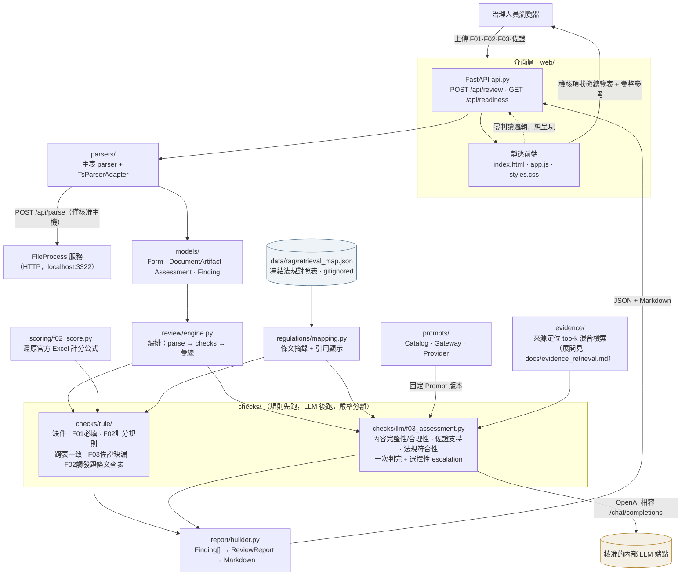
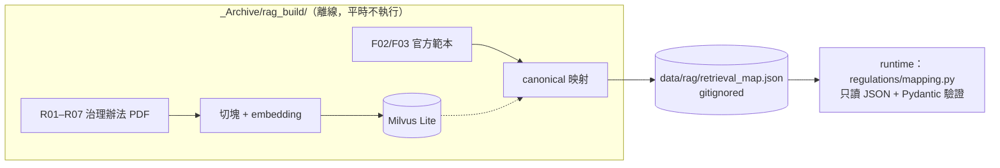
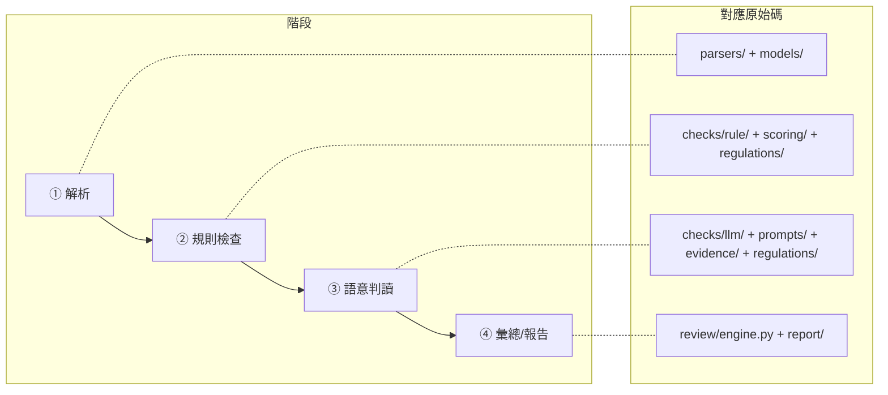
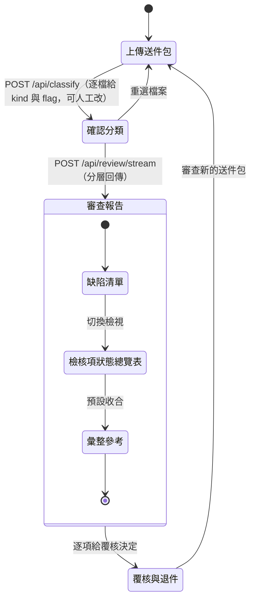

# 架構圖

本文件補充 [README.md](../README.md#架構) 的架構總覽，用圖說明四段管線如何串接，
以及介面層與前端狀態機怎麼接進主管線。
GitHub 會直接渲染下列 Mermaid 圖；本機看可用支援 Mermaid 的 Markdown 檢視器。

---

## 1. 端到端審查管線

治理人員每次上傳送件包，實際會經過的路徑——四段管線
`parsers → models → checks → review.engine → report` 之外，把「介面層」與「語意判讀」也標進來。

**關鍵設計**（對應 `CLAUDE.md` 的行為守則）：

- **規則 / LLM 嚴格分離**：`checks/rule/` 確定性、先跑、可單測、不需網路；`checks/llm/` 判讀、後跑、
  端點不可用時自動降級為單一 INFO finding，**絕不讓規則檢查因 LLM 故障而中斷**。
- **新增檢查 = 新增 Check + 在 `engine` 註冊**，不動既有程式（見 `checks/base.py` 的 `Check` 介面）。
- **地端不外送**：LLM/embedding 端點皆為環境變數指定的本機或內部位址；`web/` 前端零外部資源（CDN/字型）。
- **需求 3 與 4 合流**：「敘述是否充分」與「是否符合條文」看的是同一段文字，由 `f03_assessment`
  在同一項的同一次判讀中完成；項目可依完整 context 預算分批，但不拆成兩套互相矛盾的結論。
- **條文引用決定性推導**：報告顯示的條號一律由對照表的 canonical `section_path` 推導；
  模型回的 `gap_refs` 只作交集過濾，模型無法憑空造出不存在的條號。

---

## 2. 法規對照表（凍結資產）

`data/rag/retrieval_map.json` 由官方 R01–R07 PDF 與 F03 模板**離線建置一次**，runtime 只讀不寫、
不做向量檢索、不即時 embedding。建置管線（PDF 切塊 → embedding → Milvus → canonical 映射）
已封存於 `_Archive/rag_build/`，只有法規改版時才需取回重跑。

對應關係多半是**官方範本已內建的固定關係**（curated），語意向量檢索僅在缺 curated 映射時輔助。
缺檔時 `_load_regulation_map()` 回 `None`，報告出一筆 `REGULATION.MAP_UNAVAILABLE`（INFO），
不引用條文、不判法規符合性，其餘檢查照跑。

---

## 3. 佐證檢索（evidence/）

佐證文件解析不在本專案內：`parsers/supporting.py`（`TsParserAdapter`）只做本機預檢與主機核准，
再以 HTTP 把檔案交給 **FileProcess 服務（HTTP，localhost）** 解析（`POST /api/parse`），把回應的
chunks 對映成 `SourceUnit`；解析失敗只降級該份佐證，規則檢查照常。契約與狀態對映見
[docs/f03_review_v2.md](f03_review_v2.md)。

上圖 `evidence/` 這一個方塊自成一條子管線：佐證文件解析 → 連續原文視窗切塊 →
BM25-like（＋選用 embedding）混合排序 → 絕對相關性門檻 → 每項 top-k → 送模型 →
引用驗證與狀態降級。架構圖、逐步流程，以及**完整佐證／部分佐證／無佐證**的定義與觸發條件
（含 `unreadable`、`unknown` 兩個刻意分出來的狀態）見
[docs/evidence_retrieval.md](evidence_retrieval.md)。

一句話原則：**「找不到佐證」與「沒把佐證查完」是兩種結論**。詞面檢索永遠掃全文，語意檢索有
取樣上限；被上限截斷或 embedding 端點失敗時，空結果一律標 backend-only 的 `unknown`，
不會升級成 `not_found` 這個較強的主張。

---

## 4. 目錄 ↔ 管線階段對照

---

## 5. Web 介面：四步驟狀態機（前端）

`web/app.js` 是純 vanilla JS 狀態機，`#app` 依 `state.step` 全量重繪，事件一律走
`data-action` 委派（見 `web/app.js` 開頭的 `state` 物件與 `STEP_LABELS`）。

> 分層回傳：`/api/review/stream` 依序送出 `layer` 框（L1 規則檢查／L2 法規與佐證檢索／
> L3 敘述充分性）與 `partial`／`final` 報告框，已顯示的列不重排；串流不可用時退回
> 一次性的 `POST /api/review`。覆核決定另走 `POST /api/review/{review_id}/decisions`，
> 整批覆寫而非合併 —— 合併語意會讓「把某項改回待確認」變成不可表達。

**報告頁重點**：以 `item_assessments` 作正式資料來源，依**檢核項次**形成狀態總覽，欄位為
`項次 | 管理議題 | 提案內容 | 上線內容 | 佐證支持 | 法規符合 | 摘要`。
提案者看到缺漏、修改建議與佐證問題，審查者另看到文件狀態、Prompt 版本、信心、引用與使用量。

**檢核項名冊**（`checklist_roster`，`F03Checklist.roster()`）：`item_assessments` 只涵蓋送進語意判讀
的項次 —— 標示「不適用」或佐證欄空白者不在其中。名冊獨立於 LLM 是否啟用，把**每一個**檢核項
都帶進報告，總覽表才據以鋪滿列（未判讀者標灰、預設不計入「只看有問題」）。
沒有名冊時，這些項次會整列從報告消失：實測某份送件包 20 項中有 9 項標示不適用，
治理人員從報告上看不到自己該去認定這 9 個不適用主張。名冊的 `assessable` 與
`f03_assessment._targets()` 共用 `coverage_for_stage()` 判斷，不得各自為政。

---

## 參考

- [README.md](../README.md) — 安裝、使用流程、環境變數總覽
- [docs/evidence_retrieval.md](evidence_retrieval.md) — 佐證檢索架構、流程與佐證狀態定義
- [docs/f03_review_v2.md](f03_review_v2.md) — F03 判讀、Prompt 與 parser 整合契約
- `CLAUDE.md`（repo root）— 行為守則、目錄結構權威來源
