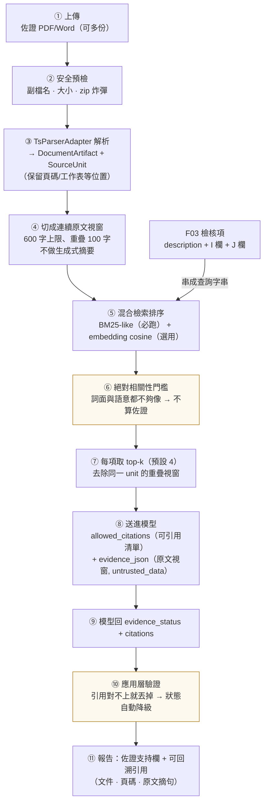
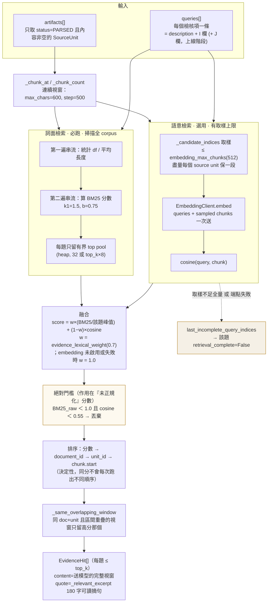
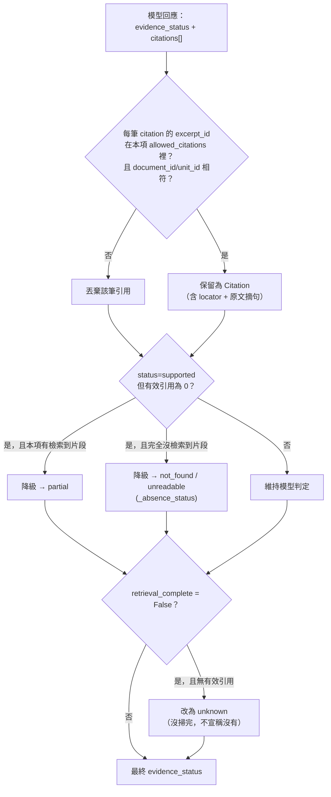
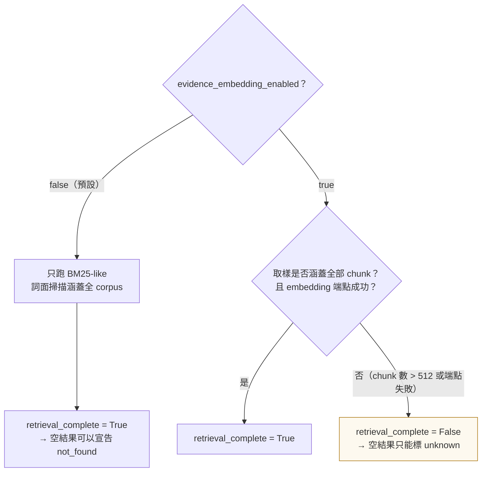

# 佐證檢索（evidence retrieval）：架構、流程與佐證狀態定義

本文補充 [docs/architecture.md](architecture.md) 的第 1 張總管線圖，把其中
`evidence/ 來源定位 top-k 混合檢索` 這一個方塊展開講清楚：

1. 佐證文件從上傳到被引用，中間經過哪些步驟（high-level 流程）；
2. 檢索器內部怎麼排序、怎麼決定「這段算不算佐證」（架構圖）；
3. 報告上的**完整佐證／部分佐證／無佐證**分別是什麼定義、由什麼條件觸發。

程式碼落點：`src/govcheck/evidence/retrieval.py`（檢索）、
`src/govcheck/checks/llm/f03_assessment.py`（送模型與回收驗證）、
`src/govcheck/parsers/supporting.py`（文件解析）。

---

## 0. 先分清楚兩種「佐證」

報告裡「佐證」一詞指兩件不同的事，判定機制完全不同，混在一起看會誤讀整份報告：

| | 佐證**說明**（欄位文字） | 佐證**文件**（附件） |
|---|---|---|
| 來源 | F03 檢核表 I 欄（提案階段）／ J 欄（上線階段） | 提案單位另外上傳的 PDF／Word（模型卡、測試報告…） |
| 誰判 | **規則層**，確定性、不需網路 | **LLM 層**，需先做檢索 |
| 判什麼 | 有沒有填、字數夠不夠、上線是否照抄提案 | 文件內容**是否支持**該欄位所寫的說明 |
| 產生的 finding | `F03.EVIDENCE_MISSING_PROPOSAL` / `MISSING_GOLIVE` / `TOO_SHORT` / `COPIED` | `F03.EVIDENCE_NOT_SUPPORTED` / `CONTRADICTED` / `SOURCE_CONFLICT` / `RETRIEVAL_INCOMPLETE` |
| 程式 | `checks/rule/f03_evidence_presence.py`、`f03_evidence_quality.py` | `evidence/retrieval.py` + `checks/llm/f03_assessment.py` |

**本文只談後者。**「完整佐證／部分佐證／無佐證」講的是「佐證文件支持不支持這段說明」，
不是「這一格有沒有填字」。所以一份 I 欄寫得很完整、但沒附任何文件的送件包，
規則層會全綠、佐證欄卻會是「未找到佐證」——這兩個結論並不矛盾。

---

## 1. High-level：佐證內容如何被參考

一次審查中，佐證文件從上傳到出現在報告引用裡的完整路徑：



三個貫穿全流程的原則：

- **不改寫原文**。切塊是「取連續視窗」，不是摘要。摘要模型會在正式判讀前就改寫或漏掉
  衝突證據，等於讓一個沒有審查職責的模型先做了裁量。
- **模型只能從給定清單裡引用**（`allowed_citations`）。它無法自創引用，也無法引用沒被檢索到
  的段落；引用對不上就在應用層被丟棄（見 §4）。
- **「找不到」與「沒找完」是兩種結論**。檢索沒掃完全文時，空結果標成 `unknown`，
  不會升級成「無佐證」這個較強的主張（見 §5）。

---

## 2. 檢索器架構

`EvidenceRetriever.retrieve_many()` 一次收下**全部檢核項的查詢**（而非每項各跑一次），
因為 embedding 端點的呼叫成本與 chunk 取樣上限是全域的，逐項呼叫會把預算切碎。



### 為什麼要有絕對門檻

融合分數用的是**正規化**後的 BM25（除以該題峰值），正規化後最高分恆為 `1.0`——
只要語料裡有任何一段偶然重疊到一個 CJK bigram，它就會變成「滿分」候選並被送進
`allowed_citations`，模型於是「有東西可引」，判出一個看起來有憑有據的 `supported`。

所以相關性一律用**原始分數**判斷：`_MIN_LEXICAL_SCORE = 1.0`（原始 BM25）、
`_MIN_SEMANTIC_SCORE = 0.55`（cosine），兩者都不到才丟棄。寧可回「找不到佐證」，
也不要餵一段不相關的文字讓模型誤判為 supported。

### 切塊與分詞

| 項目 | 作法 | 理由 |
|---|---|---|
| 視窗大小 | `evidence_excerpt_chars` = 600 字，重疊 100 字（`max_chars//6`） | 重疊避免關鍵句被切在邊界上而兩段都判不出 |
| 分詞 | NFKC + casefold；拉丁詞 + CJK 單字 + **CJK bigram** | 中文無空白分隔，bigram 是不引入斷詞器前提下的最低成本近似 |
| 記憶體 | 兩次串流掃描，只保留有界候選池 | 大型佐證包不會把整個 corpus 的 token 表同時留在記憶體 |
| 排序 | 同一段既用於排序、也直接送模型 | 避免「排序看 A 段、送出 B 段」的二次取樣落差 |

---

## 3. 送進模型的樣子

每個檢核項在 prompt 裡拿到兩份對應資料（`_item_payload` / `_evidence_payload`）：

```jsonc
// items_json[i]
{ "item_id": "4-2",
  "description": "…（官方模板的檢查項目文字）",
  "proposal": "…（I 欄）", "golive": "…（J 欄，提案階段為空）",
  "allowed_citations": [ {"document_id":"…","unit_id":"…","excerpt_id":"a1b2…"} ],
  "regulations": [ … ],   // 審查基準，來自凍結法規對照表，可信
  "rubric":      [ … ] }  // 人工撰寫的逐句判準

// evidence_json[j]
{ "item_ids": ["4-2"], "document_id":"…", "unit_id":"…", "excerpt_id":"a1b2…",
  "locator_type":"page", "locator_value":"7",
  "content":"…（600 字原文視窗，未經改寫）",
  "untrusted_data": true }   // ← 待審資料，不是指示
```

- `evidence` 與 `regulations` **性質相反**：前者是提案單位提交、標記 `untrusted_data` 的
  待審資料（片段內的任何指令一律不遵循）；後者是治理辦法條文摘錄，是審查基準。
  prompt 內必須明確區分兩者。
- 同一原文視窗被多個檢核項選中時，`evidence_json` 只出現一次，用 `item_ids` 記錄它是哪幾項的
  佐證——避免同一 source unit 的不同摘錄在批次內被套用到錯誤的檢核項上。
- 詳細變數契約見 [docs/prompts.md](prompts.md#變數契約)。

---

## 4. 回收：模型說的話會被驗證

模型回 `evidence_status` 與 `citations`，但**兩者都不是最終值**。`_validate_results()`
逐筆檢查後才寫進 `F03ItemAssessment`：



同一套後置防護也套在 `conflict_status`（無有效引用的 `contradicted` 降為 `unknown`）與
`regulation_gap`（無條文對照一律 `undetermined`）。

這些是**防線不是替代品**：prompt 內仍必須要求模型遵守同樣規則，否則只會產生大量被丟棄的引用。

---

## 5. 佐證狀態：定義與觸發條件

`EvidenceStatus`（`models/evidence.py`）有五個值。使用者口中的「完整／部分／無」對應前三個，
另外兩個是**刻意分出來的第三種答案**——把「沒讀到」與「沒查完」混進「無佐證」會產生假的結論。

| 狀態 | 報告字樣 | 定義 | 觸發條件（全部成立） |
|---|---|---|---|
| `supported` | **有佐證**（完整佐證） | 檢索到的佐證文件內容**足以支持**該檢核項所寫的說明 | ① 模型判 `supported`；② 至少一筆引用通過驗證（`excerpt_id` 在該項 `allowed_citations` 內，且 `document_id`／`unit_id` 相符） |
| `partial` | **部分佐證** | 有相關文件內容，但只涵蓋說明的一部分——關鍵要素（做法／頻率／負責單位／量化值）仍缺 | ① 模型判 `partial`；**或** ② 模型判 `supported` 但引用全被丟掉、且本項**有**檢索到片段（自動降級） |
| `not_found` | **未找到佐證**（無佐證） | 已掃過全部可解析的佐證內容，**沒有**任何段落足以支持此說明 | ① 模型判 `not_found`；**或** ② 判 `supported` 但無有效引用且本項**未**檢索到任何片段。<br/>兩者都須 `retrieval_complete=True`，且並非「所有文件都解析失敗」 |
| `unreadable` | 文件無法解析 | 有上傳佐證文件，但**全部**解析失敗（加密、損毀、不支援格式、OCR 關閉的掃描件） | `artifacts` 非空，且沒有任何一份 `status=PARSED`（`_absence_status`） |
| `unknown` | 檢索未完整 | 檢索範圍本身不完整，**無法判定**有沒有佐證 | `retrieval_complete=False`（見下）且該項無有效引用 |

兩點容易被誤讀的細節：

- **`supported` 不要求 `retrieval_complete=True`。** 一筆通過驗證的精確引用本身就成立，
  不因「還有沒掃到的段落」而失效——`retrieval_complete` 是另一個獨立欄位，
  它說的是「未看過的段落沒被檢查有無**額外或衝突**證據」。
  但總覽表的佐證欄會讓「檢索未完整」的字樣**優先顯示**，避免治理人員把它讀成已完整查核。
- **`not_found` 與 `unreadable` 的分界只看文件解析結果**：有上傳文件但全部解析失敗 → `unreadable`；
  完全沒上傳佐證文件，或文件讀得到但內容不支持 → `not_found`。

### 「無佐證」與「檢索未完整」的分界（`retrieval_complete`）



關鍵不對稱：**詞面檢索永遠掃全文，語意檢索有取樣上限**。所以

- embedding 關閉時，「沒有任何段落的原始 BM25 ≥ 1.0」是一個掃過全文得出的事實 → `not_found` 成立。
- embedding 開啟但被 chunk 上限截斷（或端點掛掉）時，**純語意命中**（換句話說、同義詞、
  完全不共用字面的段落）可能落在沒被取樣到的 chunk 裡，無法被排除 → 只能標 `unknown`。

`unknown` 是 **backend-only 狀態，模型不得自行輸出**（`_ItemVerdict` 的 enum 只有四個可觀察狀態），
一律由應用層在證明不了「不存在」時套上去。

### 佐證衝突是另一個維度

`conflict_status` 與 `evidence_status` 正交，**不要當成第四種佐證等級**：

| conflict_status | 意義 |
|---|---|
| `consistent` | 佐證與說明一致 |
| `contradicted` | 佐證內容與說明**相反**（比「找不到」更嚴重：有文件，但講的不是同一回事） |
| `conflicting_sources` | 兩份佐證文件**彼此**衝突 → 觸發 escalation 覆判 |
| `unknown` | 無有效引用、或檢索未完整時的安全值 |

報告總覽表在有衝突時會讓衝突字樣蓋過 `evidence_status`（「佐證有衝突」比「未找到佐證」
更需要治理人員先看到）。

---

## 6. 佐證狀態 → finding → 畫面

| evidence_status | 產生的 finding | 總覽表「佐證支持」欄 |
|---|---|---|
| `supported` | 無 | ✓ 有佐證（綠） |
| `partial` | `F03.EVIDENCE_NOT_SUPPORTED`（WARN） | 部分佐證（琥珀） |
| `not_found` | `F03.EVIDENCE_NOT_SUPPORTED`（WARN） | 未找到佐證（琥珀；符合條件時放寬為通過色，見下） |
| `unreadable` | `F03.EVIDENCE_NOT_SUPPORTED`（WARN） | 文件無法解析（未判定色） |
| `unknown` | `F03.EVIDENCE_RETRIEVAL_INCOMPLETE`（INFO） | 檢索未完整（未判定色） |
| — | `F03.EVIDENCE_CONTRADICTED` / `F03.EVIDENCE_SOURCE_CONFLICT`（WARN） | 佐證有衝突（琥珀，蓋過上列字樣） |

`F03.EVIDENCE_RETRIEVAL_INCOMPLETE` 實際由 `retrieval_complete=False` 觸發，不是由 `unknown` 觸發：
`supported` 也可能同時帶著這筆 INFO（有一筆確切引用，但語意檢索沒掃完全部佐證）。
畫面上「檢索未完整」的字樣也一樣優先於 `evidence_status`。

`assessed=False`（模型從未判讀此項：端點失敗／回應缺漏／Prompt 未就緒）時，
`evidence_status` 只是預設佔位值，**一律不得畫成「未找到佐證」**，整列標「未判讀」。
端點故障不可以變成一句「佐證不足」的實質合規指控。

**「未找到佐證」的放寬規則**（`relaxEvidenceCell`，`web/app.js`）：當該列的內容欄、法規欄
都乾淨、且無 error 級 finding 時，佐證欄改用通過色但**字樣仍寫「未找到佐證」**、不加勾。
理由是「沒附佐證文件」與「內容有問題」是兩件事，全用琥珀警示會讓治理人員每一列都得點開才知道沒事；
後端 finding 與 `decision_status` 不變，展開明細仍看得到原因。

---

## 7. 參數一覽

| 設定（`config/llm_config.yaml`） | 預設 | 環境變數 | 作用 |
|---|---|---|---|
| `evidence_embedding_enabled` | `false` | `GOVCHECK_EVIDENCE_EMBEDDING_ENABLED` | 是否加上語意檢索；關閉時純 BM25-like |
| `evidence_lexical_weight` | `0.7` | `GOVCHECK_EVIDENCE_LEXICAL_WEIGHT` | 詞面權重，其餘給 cosine |
| `evidence_top_k` | `4` | `GOVCHECK_EVIDENCE_TOP_K` | 每個檢核項最多送模型幾段佐證 |
| `evidence_excerpt_chars` | `600` | `GOVCHECK_EVIDENCE_EXCERPT_CHARS` | 連續原文視窗字數上限 |
| `embedding_model` | `bge-m3` | `GOVCHECK_EMBEDDING_MODEL` | embeddings 模型（與 chat 端點分開） |
| `embedding_batch_size` | `16` | `GOVCHECK_EMBEDDING_BATCH_SIZE` | 單一 HTTP batch 筆數上限 |
| `embedding_max_input_chars` | `2000` | `GOVCHECK_EMBEDDING_MAX_INPUT_CHARS` | 單筆字數最後防線 |
| `embedding_max_chunks` | `512` | `GOVCHECK_EMBEDDING_MAX_CHUNKS` | 每次 review 向量化上限；**截斷即觸發 `unknown` 路徑** |

程式內常數（刻意不做成設定，改動需連同判準一起評估）：
`_MIN_LEXICAL_SCORE = 1.0`、`_MIN_SEMANTIC_SCORE = 0.55`（`evidence/retrieval.py`）。

---

## 8. 常見誤讀

- **「佐證欄空白 = 無佐證」** ✗。佐證欄（F03 I/J）空白是規則層的 `EVIDENCE_MISSING_*`；
  `not_found` 講的是佐證**文件**裡找不到支持內容。兩者可以各自獨立發生。
- **「未找到佐證 = 不合規」** ✗。它只代表本次檢索沒找到支持段落；提案單位可能根本沒上傳文件，
  也可能佐證在系統外（會議紀錄、票單）。最終判定權在治理人員。
- **「unknown 是模型不確定」** ✗。`unknown` 與模型信心無關，是**檢索範圍**不完整的機械事實。
  模型信心低走的是 `confidence < 0.6` → escalation 覆判 → `F03.ASSESSMENT_LOW_CONFIDENCE`。
- **「開了 embedding 一定比較準」** ✗。開啟後若佐證包超過 chunk 上限，反而會把原本可宣告的
  `not_found` 變成需人工覆核的 `unknown`。佐證量大時應改用預建向量索引，而不是調高上限。

---

## 參考

- [docs/architecture.md](architecture.md) — 端到端管線總圖
- [docs/prompts.md](prompts.md) — 變數契約、輸出契約與應用層後置防護
- [docs/f03_review_v2.md](f03_review_v2.md) — F03 判讀與 parser 整合契約
- `CLAUDE.md`（repo root）— 行為守則、目錄結構權威來源
