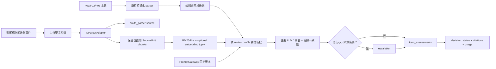

# F03 review v2：執行與整合契約

## Runtime 流程



`F01`、`F02`、`F03` 主表不交給 `ts_parser`。單一佐證文件解析失敗只影響該文件，規則與其他
文件繼續執行；`unreadable`、`not_found` 與 `contradicted` 是不同語意。

## API

`POST /api/review` 以 multipart form 提供：

- `f01` / `f02` / `f03`: 各一份表單檔（選填；未上傳由缺件檢查列出）。
- `supporting`: 佐證文件，可多份。
- `workflow_stage`: `proposal`（預設）、`acceptance` 或 `production`。
- `enable_llm`: 選填；省略時採應用設定。

回應欄位：

- `decision_status`: `approved | changes_required | manual_review | incomplete`
  （唯一的通過訊號；刻意不回 `passed`，避免兩個訊號互相矛盾）。
- `item_assessments`: 每一 F03 項目的完整性、合理性、證據、衝突、**法規符合性**、信心、引用與建議。
- `checklist_roster`: 全部檢核項的涵蓋狀態（含未送判讀者）。
- `document_statuses`: 去除內容後的 parser 狀態與版本資訊。
- `citations`: 所有有效引用的扁平集合。
- `usage_summary`: parser OCR/VLM、evidence embedding、review primary/escalation、tokens、延遲、快取命中。
- `review_run_meta`: workflow、Prompt 固定版本、parser source、政策、schema 與模型版本。
- `findings` / `markdown`: 逐筆發現與可下載的 Markdown 報告。

## Prompt 契約

正式 Prompt 僅存在 Prompt Management 環境。程式碼只保存七個 Prompt ID、必要變數、profile、
schema version 與最低應用版本。每次 review run 重新解析 mutable label，取得不可變 version 後全程
固定；只有 exact version 可使用程序內快取。由於 LiteLLM Generic API 本身未規定 label/version 欄位，
遠端服務須在相容契約上加送 `prompt_version`，並接受 `prompt_label`／`prompt_version` query parameter；
缺少不可變版本時 readiness 會失敗。

Prompt 平台的 model 與 optional parameters 不會傳入 Chat client。模型、temperature、timeout、
重試、circuit breaker 與 JSON schema 都由應用程式控制。正式上線前呼叫：

```text
GET /api/readiness
```

七個 Prompt 都必須回傳版本；任何 `unavailable:*` 都不得導入正式流量。

## Parser 設定與同步

設定集中在 `src/govcheck/config/parser_config.yaml`，可由 `.env.example` 所列環境變數覆寫。`auto` Word
策略優先 native；Melody、OCR/VLM 都是明確 feature flag。暫存目錄按作業隔離並於完成後清理，
parser 不得自行載入 `.env` 或寫持久化 scan log。

目前取得的 `arkkb/src/ts_parser` 目錄沒有 `.git`，因此無法建立真正的 split branch/subtree commit。
本專案先以 source snapshot 放在最終 prefix `src/ts_parser/`；來源與原始檔 hash 記錄於
`docs/ts_parser_source.md` 及 `docs/ts_parser_source.sha256`。取得上游 Git URL、branch 與 commit 後，應：

1. 在上游 repository 對 `src/ts_parser` 建立 split branch。
2. 以 `git subtree add --prefix=src/ts_parser <remote> <split-branch> --squash` 取代 snapshot。
3. 記錄 upstream commit 與本地修正摘要。
4. 執行完整 parser contract tests 與 build 驗證，人工核准後才部署。

AI治理專屬行為留在 `govcheck.parsers.supporting`；共用修正先回饋上游再 subtree pull。若不得不直接
修 subtree，必須使用獨立 commit。

## 上線驗收

程式測試只驗證契約、狀態語意、安全降級與呼叫計數；品質門檻仍需以至少 10 組去識別案例、兩位
業務審查者的 ground truth 執行 shadow mode。支持／衝突 precision 與 recall、citation 定位、成本、
呼叫量與延遲未達計畫門檻前，不應停用 v1 adapter。
