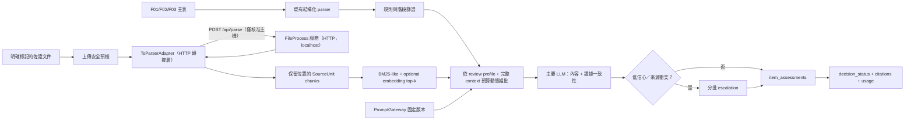

# F03 review v2：執行與整合契約

## Runtime 流程



`F01`、`F02`、`F03` 主表不交給 FileProcess 服務。單一佐證文件解析失敗只影響該文件
（`parser_unavailable` / `unsupported` / `unreadable`），規則與其他文件繼續執行；
`unreadable`、`not_found` 與 `contradicted` 是不同語意。
若 bounded embedding 未涵蓋全文，空結果使用 backend-only 的 `unknown`，表示檢索不完整而不是
已證明沒有佐證。上圖 `H`（BM25-like + optional embedding top-k）的內部架構、逐步流程與各佐證
狀態的觸發條件見 [docs/evidence_retrieval.md](evidence_retrieval.md)。

## API

網頁先呼叫 `POST /api/classify`，以 repeated `files` 取得每檔的建議類別、判定原因與
重複／無法辨識旗標。應用不持久化預覽檔；框架可能將大型 request 暫存於
作業系統目錄，request 結束後即清除。

使用者確認或修正後，`POST /api/review` 的批次模式以 multipart form 提供：

- `files`: 原順序的整批檔案，可多份。
- `kinds`: 與 `files` 等長的 JSON 陣列，值為 `f01 | f02 | f03 | supporting | ignore`。
- `workflow_stage`: `proposal`（預設，提案送審）或 `golive`（上線送審）。
- `enable_llm`: 選填；省略時採應用設定。

為相容既有呼叫端，`POST /api/review` 也接受預先分欄模式：

- `f01` / `f02` / `f03`: 各一份表單檔（選填；未上傳由缺件檢查列出）。
- `supporting`: 佐證文件，可多份。
- `workflow_stage`: `proposal`（預設，提案送審）或 `golive`（上線送審）。
- `enable_llm`: 選填；省略時採應用設定。

批次與預先分欄模式不可混用。忽略項目會寫入最終 findings，但不會送入 parser。

回應欄位：

- `decision_status`: `approved | changes_required | manual_review | incomplete`
  （唯一的通過訊號；刻意不回 `passed`，避免兩個訊號互相矛盾）。
- `item_assessments`: 每一 F03 項目的完整性、合理性、證據、`retrieval_complete`、衝突、
  **法規符合性**、信心、引用與建議。
- `checklist_roster`: 全部檢核項的涵蓋狀態（含未送判讀者）。
- `document_statuses`: 去除內容後的 parser 狀態與版本資訊。
- `citations`: 所有有效引用的扁平集合。
- `usage_summary`: parser 遠端呼叫（`parser_remote_calls`；`parser_ocr_calls`/`parser_vlm_calls`
  為相容保留、恆為 0）、evidence embedding、review primary/escalation、tokens、延遲、快取命中。
- `review_run_meta`: workflow、Prompt 固定版本、parser source、政策、schema 與模型版本。
- `findings` / `markdown`: 逐筆發現與可下載的 Markdown 報告。

## Prompt 契約

正式 Prompt 僅存在 Prompt Management 環境。程式碼只保存七個 Prompt ID、必要變數、profile、
schema version 與最低應用版本。每次 review run 重新解析 mutable label，取得不可變 version 後全程
固定；只有 exact version 可使用程序內快取。由於 LiteLLM Generic API 本身未規定 label/version 欄位，
遠端服務須在相容契約上加送 `prompt_version`，並接受 `prompt_label`／`prompt_version` query parameter；
缺少不可變版本時 readiness 會失敗。

Prompt 平台的 model 與 optional parameters 不會傳入 Chat client。模型、temperature、timeout、
重試、circuit breaker 與 JSON schema 都由應用程式控制。正式上線前呼叫：

Chat client 另以部署設定的 context window、輸出預留與安全邊界做送出前預檢；primary 與
escalation 都按完整 rendered prompt 分批。context 400 或輸出截斷只會縮小該批重試，不會將
前一批 prompt 累積成對話歷史。

```text
GET /api/readiness
```

七個 Prompt 都必須回傳版本；任何 `unavailable:*` 都不得導入正式流量。

## Parser 設定與整合契約（FileProcess 服務，HTTP，localhost）

gov_doc **不內嵌任何解析程式**。佐證一律由 `govcheck.parsers.supporting.TsParserAdapter` 以
`POST {fileprocess_url}/api/parse` 交給既有的 FileProcess 專案（預設 `http://localhost:3322`）解析；
解析器 bug 一律修在 FileProcess，本專案只做轉接與降級。

設定集中在 `src/govcheck/config/parser_config.yaml`，可由 `.env.example` 所列
`GOVCHECK_PARSER_*` 環境變數覆寫（`FILEPROCESS_URL`、`FILEPROCESS_TIMEOUT`、`ENABLED_FORMATS`、
`APPROVED_MODEL_HOSTS`、`MAX_FILE_BYTES`、`MAX_PAGES`＝chunk 數上限）。

轉接層責任與契約：

- **預檢在本機**：副檔名白名單、大小、PDF/OLE/zip 簽章、zip-bomb 比率，不通過就不發請求。
- **主機核准**：`fileprocess_url` 的主機必須列於 `approved_model_hosts`，否則回
  `parser_unavailable`（`fileprocess_host_not_approved`）且**不發請求**，佐證內容不出本機。
- **請求**：`{"filename": "<document_id><ext>", "file_content": <base64>, "metadata": {}}`，
  只送不透明檔名，原始檔名不外傳；呼叫受 `MODEL_CALL_SEMAPHORE` 節流，`parser_remote_calls` 遞增。
- **回應**：`{"filename", "chunks": [{content, page, filename, from_file, is_attachment?}]}` →
  `SourceUnit(unit_id="<document_id>:<i>", locator_type="page"|"attachment",
  locator_value=str(page), attachment_path=filename if is_attachment)`。
- **狀態對映（絕不 raise、絕不記錄回應內文）**：連線錯誤／逾時／5xx → `parser_unavailable`
  （`fileprocess_unavailable`）；415 → `unsupported`（`parser_not_supported`）；400/413/422 →
  `unreadable`（`fileprocess_rejected`）；契約不符 → `unreadable`（`fileprocess_contract_mismatch`）；
  全空 → `unreadable`（`empty_parser_output`）；chunk 數超上限 → `unreadable`（`page_limit_exceeded`）。
- `review_run_meta.parser_source_commit` = `fileprocess@<host>`；`fileprocess_readiness()` 以
  `GET /health`（2 秒逾時）回報 `{url_host_approved, reachable}` 給 `/api/readiness`。

測試一律以 `tests/conftest.py` 的 `fake_fileprocess` fixture 替換 `requests.post/get`，不打真服務。

## 上線驗收

程式測試只驗證契約、狀態語意、安全降級與呼叫計數；品質門檻仍需以至少 10 組去識別案例、兩位
業務審查者的 ground truth 執行 shadow mode。支持／衝突 precision 與 recall、citation 定位、成本、
呼叫量與延遲未達計畫門檻前，不應停用 F03 v1 判讀路徑。

此條只約束「判讀」，不約束「解析」。佐證解析改走 FileProcess 是格式涵蓋與部署位置的變更：
`SourceUnit` 的輸出契約（含 locator 保留）未變，且由 `tests/test_supporting_parser.py` 覆蓋，
不影響判讀品質，因此內嵌的 `src/ts_parser/` 已於遷移時移除。若校準期間發現解析迴歸，
該套件可從 git 歷史取回比對。
